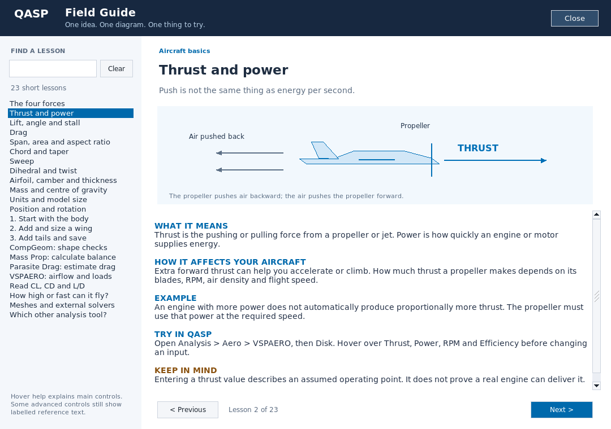
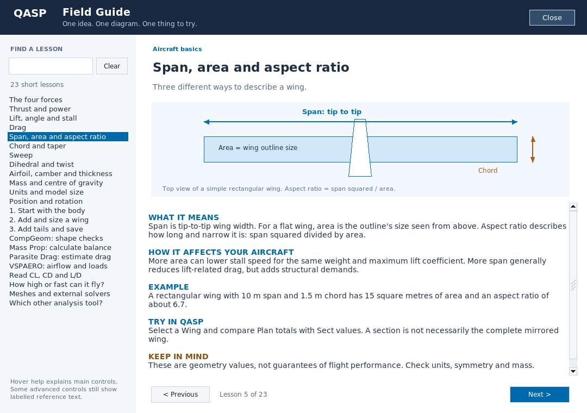

# Beginner help revision after first-release testing

The first release launched successfully on the user's PC, but its Field Guide
and hover text did not meet the intended beginner-help standard. Raw technical
labels had been counted as helpful coverage. This revision corrects that scope.

## What changed

- 135 authored **context-specific** parameter explanations, covering 129 names.
  Every entry includes a definition, effect and example; units are given where
  appropriate. This is deliberately **not** described as coverage of every field.
- Air density versus material density, wing area versus body-section area, and
  fuselage versus pod length receive separate explanations.
- A reused control refreshes its explanation when its meaning changes, instead
  of keeping the help from the first bound parameter.
- Advanced descriptions remain available under the explicit `Reference:` label.
- The guide now contains 23 focused lessons rather than long plain-text pages.
  Each has a native diagram, meaning, effect, example, task and limitation.
- All lesson and tooltip copy is embedded and works offline.
- Existing portable-folder layout is unchanged. No installer, no single-file EXE.

## Actual component screenshots

These screenshots show the **real compiled Field Guide code**, using the exact
bundled **FLTK 1.4.2** source snapshot in a **Linux component-test harness**.
They are **not** mock-ups, AI-generated UI, screenshots of the complete QASP
geometry engine, or evidence that the new Windows package has been tested.

### Thrust and power

### Span, area and aspect ratio

## Validation and limits

Run `bash tools/run_qasp_help_checks.sh`; see `tools/README-qasp-help.md`.
The suite checks source keys, generated copy, lookup context, text formatting,
rebinding, explicit overrides, search, navigation, resize, close and reopen.
All 23 lesson diagrams are loaded in the actual native component.

Pure C++ tests run with address and undefined-behaviour sanitizers. Focused GUI
checks do not replace the full application build or Windows runtime testing.
The Windows portable integration build is a separate gate in the release pipeline.

There are still advanced controls without beginner-authored copy. There is no
validated automatic top-speed or maximum-altitude calculator in this revision.
The illustrations and worked numbers are educational, not design certification.
