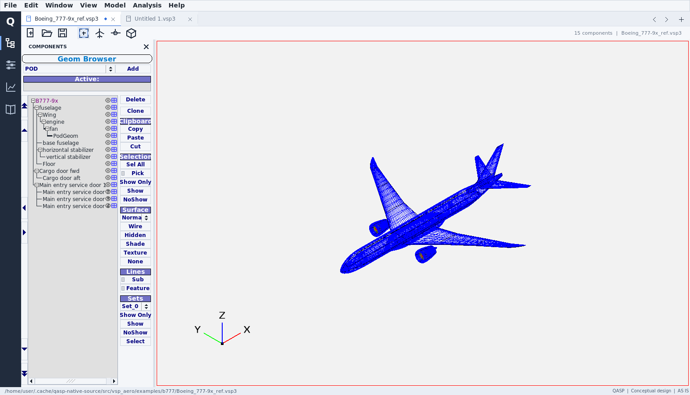
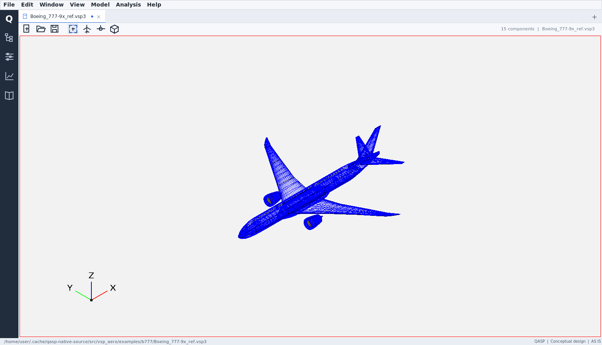

# QASP workspace: actual Linux application screenshots

These are unmodified screenshots of the **full native modeling application**,
not a mockup or a standalone workspace component. The application was built from
source revision `b15b293c029d20f9c367bcc8d777b2528b21b064` using GCC and the
bundled FLTK 1.4.2, then run under X11/Xvfb with Mesa software rendering.

## Component tree and project tabs

The aircraft is the upstream-supplied `Boeing_777-9x_ref.vsp3` example. It is a
geometry example, not a validated aircraft design or performance result.

During capture, the actual UI created a second empty project with Ctrl+N,
accepted the reload warning, and switched back with Ctrl+Shift+Tab. The aircraft
rendered again and its 15 components appeared in the hosted tree.

## Expanded drawing area

The sidebar is hidden on startup. Its icon opens it on demand. The filename
strip is 18 pixels high and the workspace toolbar is 30 pixels high.

## Scope and limitations

- The native `vsp` application target compiled and linked successfully.
- These captures are **not a Windows runtime test or a released portable ZIP**.
- This Linux validation configuration did not build the external VSPAERO solver,
  viewer, loads tool or full reference-help files. No analysis result is claimed.
- The focused tests previously passed 93 coordinator/filesystem checks with a
  fake host and 85 actual FLTK workspace checks. They are not a complete engine,
  model-setup round-trip, graphics-driver or Windows validation suite.
- Results/mesh previews, undo and the clipboard are transient across tab reloads.
- Working copies are not guaranteed autosave or crash recovery. Read
  [Risks and limitations](../RISKS_AND_LIMITATIONS.md).

Reproduction: `tools/capture_qasp_workspace.py`; capture metadata and raw
application startup output are alongside the PNGs.
